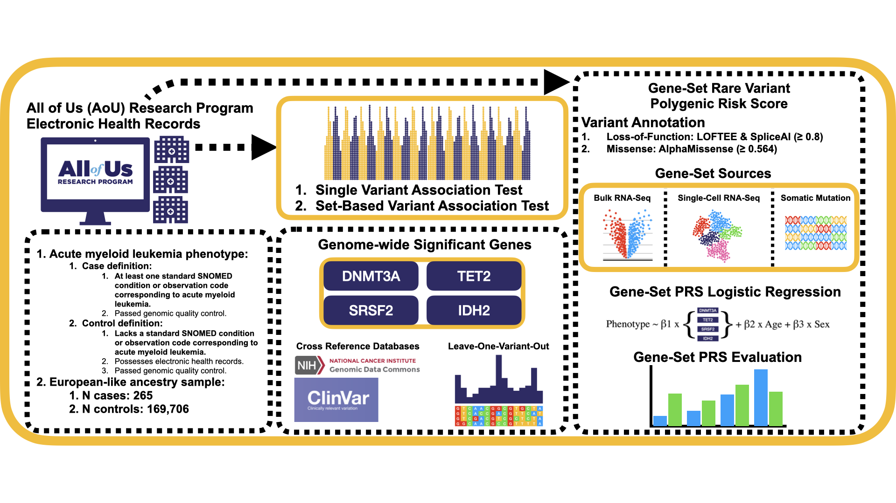

# Rare Variant Analysis for Acute Myeloid Leukemia Using the All of Us Whole Exome Sequencing Data

Insert Abstract

## AoU Workspace 
- [Environment Scripts](https://github.com/StephenVieno/Rare-Variant-Analysis-of-EHR-Derived-AML-in-the-AoU/tree/main/AoU-Workspace/Environment-Scripts)

- [Phenotype Scripts](https://github.com/StephenVieno/Rare-Variant-Analysis-of-EHR-Derived-AML-in-the-AoU/tree/main/AoU-Workspace/Phenotype-Scripts)
  
- [Genetic Relationship Matrix Scripts](https://github.com/StephenVieno/Rare-Variant-Analysis-of-EHR-Derived-AML-in-the-AoU/tree/main/AoU-Workspace/Genetic-Relationship-Matrix-Scripts)

- [Single-Variant-Association-Scripts](https://github.com/StephenVieno/Rare-Variant-Analysis-of-EHR-Derived-AML-in-the-AoU/tree/main/AoU-Workspace/Single-Variant-Association-Scripts)

- [Set-Based-Association-Scripts](https://github.com/StephenVieno/Rare-Variant-Analysis-of-EHR-Derived-AML-in-the-AoU/tree/main/AoU-Workspace/Set-Based-Association-Scripts)

  - [Annotation-Sensitivity-Scripts](https://github.com/StephenVieno/Rare-Variant-Analysis-of-EHR-Derived-AML-in-the-AoU/tree/main/AoU-Workspace/Annotation-Sensitivity-Scripts)

  - [Leave-One-Variant-Out-Scripts](https://github.com/StephenVieno/Rare-Variant-Analysis-of-EHR-Derived-AML-in-the-AoU/tree/main/AoU-Workspace/Leave-One-Variant-Out-Scripts)

- [Burden-Polygenic-Risk-Score-Scripts](https://github.com/StephenVieno/Rare-Variant-Analysis-of-EHR-Derived-AML-in-the-AoU/tree/main/AoU-Workspace/Burden-Polygenic-Risk-Score-Scripts)

  - [Covariate-Sensitivity-Scripts](https://github.com/StephenVieno/Rare-Variant-Analysis-of-EHR-Derived-AML-in-the-AoU/tree/main/AoU-Workspace/Covariate-Sensitivity-Scripts)

- [GAUSS-Scripts](https://github.com/StephenVieno/Rare-Variant-Analysis-of-EHR-Derived-AML-in-the-AoU/tree/main/AoU-Workspace/GAUSS-Scripts)

## Local Workspace 
- [Annotation Scripts](https://github.com/StephenVieno/Rare-Variant-Analysis-of-EHR-Derived-AML-in-the-AoU/tree/main/Local-Workspace/Annotation-Scripts)

- [Gene Set Scripts](https://github.com/StephenVieno/Rare-Variant-Analysis-of-EHR-Derived-AML-in-the-AoU/tree/main/Local-Workspace/Gene-Set-Scripts) 
  - [Bulk RNA-Seq Scripts](https://github.com/StephenVieno/Rare-Variant-Analysis-of-EHR-Derived-AML-in-the-AoU/tree/main/Local-Workspace/Gene-Set-Scripts/Bulk-RNA-Seq-Scripts) 
  - [Single-Cell RNA-Seq Scripts](https://github.com/StephenVieno/Rare-Variant-Analysis-of-EHR-Derived-AML-in-the-AoU/tree/main/Local-Workspace/Gene-Set-Scripts/Single-Cell-RNA-Seq-Scripts) 
  - [Somatic Mutation Gene-Sets](https://github.com/StephenVieno/Rare-Variant-Analysis-of-EHR-Derived-AML-in-the-AoU/tree/main/Local-Workspace/Gene-Set-Scripts/Somatic-Mutation-Gene-Sets)

- [Post Single Variant Association Scripts](https://github.com/StephenVieno/Rare-Variant-Analysis-of-EHR-Derived-AML-in-the-AoU/tree/main/Local-Workspace/Post-Single-Variant-Association-Scripts) 

